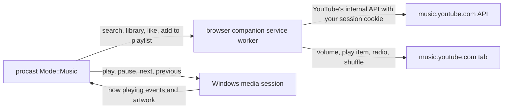

# YouTube Music for procast (native, low resource)

One player: **music.youtube.com in Chrome, Edge or Brave**, controlled natively from Rust in the same way as Clipboard or Browser Tabs. The store's `youtube-music` extension can't be reused because it is macOS-only AppleScript.

## Why the browser, not a desktop app
- **No extra app running.** Desktop clients such as YTMDesktop or th-ch's YouTube Music are Electron apps that use hundreds of MB. The browser tab is already open while you listen.
- **Your library is available.** Desktop-client APIs don't expose search or your saved albums, so a desktop client would still need the browser for those. Using only the browser keeps everything on one path.
- **No pairing or tokens.** Requests use your existing logged-in browser session, and procast stores no credentials.

## Resource budget
- **Native, not a Raycast JS extension.** The extension route would start the Node extension host, which uses 90–120 MB.
- **No new process and no new crate.** It uses `serde` and `windows`, which are already dependencies, plus one new `windows` feature, `Media_Control`.
- **Nothing runs while the launcher is closed**, except a Windows media-session event subscription when the tray player is on. There is no polling loop.
- Your library is cached to disk and refreshed only when you open the mode and the cache is more than 10 minutes old.
- Cover art goes through the existing `net::fetch_image` disk cache. Only the visible thumbnails are decoded.

## Where the data comes from



- **Your library and search** go through procast's existing browser companion.
  - Its service worker calls YouTube Music's internal API (`/youtubei/v1/browse`, `/search`, `/like/like`, `/like/dislike`, `/browse/edit_playlist`).
  - It signs requests from your logged-in session: it reads the `SAPISID` cookie with `chrome.cookies` and builds YouTube's `SAPISIDHASH` authorization header. **No YouTube Music tab needs to be open** for this.
  - Library pages are fetched by their YouTube page IDs:
    - albums: `FEmusic_liked_albums`
    - playlists: `FEmusic_liked_playlists`
    - artists: `FEmusic_library_corpus_artists`
    - liked songs: `VLLM`
    - an album's tracks: `MPREb_…`
  - The service worker turns each large API response (hundreds of KB) into a small list of `{kind, id, playlistId, title, subtitle, thumb, duration}`. Rust only receives that compact JSON.
- **Play, pause, next and previous** go straight to Windows' System Media Transport Controls (`GlobalSystemMediaTransportControlsSessionManager`). This is the cheapest path: one in-process call, with no browser round trip.
- **Everything else the tab does** goes through a new `ytm` companion request. It runs `chrome.scripting.executeScript` in the page's own context in the `music.youtube.com` tab:
  - volume, through the page's player object (`#movie_player` `setVolume` / `mute`)
  - shuffle and repeat
  - playing a specific song or album by navigating the tab to `watch?v=…&list=…`
  - If no YouTube Music tab is open, the existing `open` request creates one.
- **Now Playing and the tray** read the same Windows media session, filtered to the browser's YouTube Music session. Title, artist, artwork and play state arrive as events, with no polling and no network.

## Commands
All of these are root commands, so each one can have its own hotkey and alias.
- **Search YouTube Music:** songs, albums, artists or playlists. Tab cycles the filter, like the dropdown in your screenshot. Albums show as a grid.
- **Your Library:** Albums (grid), Playlists, Artists, Liked Songs. Enter opens an album or playlist to show its tracks. Ctrl+Enter plays it.
- **Now Playing:** a detail view with the cover, track, artist, album and play state.
- **Quick Actions:** Like, Dislike, Play/Pause, Next, Previous, Volume Mute/Low/Medium/High/Up/Down, Shuffle, Repeat. Each one is also a standalone root command.
- **Tray Player** (`tray = true`): a tray icon with the current track as its tooltip. Its menu has Play/Pause, Like, Next, Previous, Start Radio, Add to Playlist, Copy URL and Open in YouTube Music.
- **Ctrl+K on any song or album:** Play, Start Radio (`list=RDAMVM<id>`), Like, Add to Playlist (submenu of your playlists), Copy URL, Open in YouTube Music.
- **Not included:** "Connect Device" from your Spotify screenshots. YouTube Music has no public equivalent of Spotify Connect.

## Config (`config.toml`)
```toml
[ytmusic]
enabled = true
tray = false
columns = 5            # album grid
volume_step = 10
```

## Files to change
- New [src/ytmusic.rs](src/ytmusic.rs): item and track types, request builders for the companion, the Windows media-session listener and controls, the library cache (`%APPDATA%\procast\ytmusic\library.json`), and unit tests.
- [browser/background.js](browser/background.js) and [browser/manifest.json](browser/manifest.json): new `ytm` request kinds (`search`, `browse`, `like`, `dislike`, `addToPlaylist`, `control`, `play`). New permissions: `cookies`, `scripting`, and host access to `https://music.youtube.com/*`. The manifest `key` stays the same, so the extension ID doesn't change. You will need to click "Reload" once on the unpacked extension.
- [src/browser.rs](src/browser.rs): a `Reply::Music(...)` variant and its parser, with tests.
- [src/win.rs](src/win.rs): `Msg::NowPlaying(...)`. Music replies arrive through the existing `Msg::Browser`.
- [src/search.rs](src/search.rs): `Act::Music(MusicAct)` for play, open album, like, add to playlist and the transport controls.
- [src/commands.rs](src/commands.rs): `Cmd` variants and `ALL` entries for the commands above.
- [src/main.rs](src/main.rs):
  - `Mode::Music(MusicView)` with views for Search, Library, Album/Playlist, Now Playing and Quick Actions, plus rows, placeholder, title and icon.
  - When no browser is connected, an empty state that points to "Set Up Browser Extension", the same as the Tabs mode.
  - `grid()` extended so album views use `grid_rows` with `columns`.
  - A tray player built the same way as the existing menu-bar tray code (around line 1326).
- [src/ext.rs](src/ext.rs): give `load_image` a size parameter. It caps images at 64 px today; the album grid needs about 128 px.
- [src/config.rs](src/config.rs) and [src/settings.rs](src/settings.rs): the `[ytmusic]` section.
- [Cargo.toml](Cargo.toml): add the `Media_Control` feature to `windows`.
- [README.md](README.md): a feature line and setup steps.

## Verification
- Unit tests for parsing the companion's compact replies and for building `ytm` requests.
- `spikes/e2e.py`:
  - open Your Library and see your albums in the grid
  - Enter opens an album's tracks, Ctrl+Enter plays it
  - Next changes the Now Playing title (seen through the media-session event)
- Measure procast's private memory before and after opening the mode and browsing the library. The target is under +10 MB, with no extra process.
