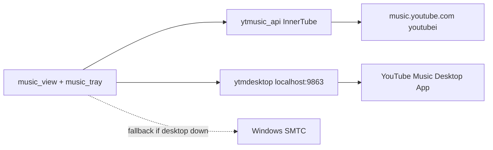

# YouTube Music: desktop player + direct catalog search

> **For agentic workers:** REQUIRED SUB-SKILL: Use superpowers:subagent-driven-development (recommended) or superpowers:executing-plans to implement this plan task-by-task. Steps use checkbox (`- [ ]`) syntax for tracking.

**Goal:** Keep the existing YouTube Music UI, search the YouTube Music catalog from procast without Chrome open, and play results in the installed YouTube Music Desktop App.

**Architecture:** Split the old “everything through the browser companion” path into two backends. **Catalog** (search, browse, library pages) becomes InnerTube HTTP from Rust via existing `ureq` (`src/ytmusic_api.rs`), reusing types/cache/request shapes in `src/ytmusic.rs` and porting the response walker from `browser/ytmusic.js`. **Player** becomes the YTMDesktop Companion Server on `http://127.0.0.1:9863` (`src/ytmdesktop.rs`): auth token, Socket.IO state, `POST /command` including `changeVideo`. `src/music_view.rs` / `src/music_tray.rs` stay; only their send paths and Now Playing source change. Browser `ytm` play/tab-control is removed; an optional one-shot “Import session” may remain for signed library.

**Tech Stack:** Rust 2024, existing `ureq` + `serde`/`serde_json`, Windows `Media_Control` (fallback only), YTMDesktop Companion API v1 (localhost:9863). No new crates unless Socket.IO cannot be done with a tiny raw WebSocket; prefer HTTP `/state` + event-driven refresh from command replies first, Socket.IO only if needed for tray freshness without polling.

**Spec:** This plan (user-approved hybrid: InnerTube search in-process + desktop app playback). Prior plan `docs/superpowers/plans/2026-11-17-youtube-music.md` is historical for the UI that already shipped on `feat/ytmusic`.

## Global Constraints

- Work only in worktree `D:\Pro\akscast\.claude\worktrees\ytmusic` on branch `feat/ytmusic` (or a new branch from it). Never touch `D:\Pro\akscast` root, never push/merge without asking.
- **Reuse, don’t rewrite:** keep `MusicState`, screens, grid, Relay, tray menu model, `Control`/`Filter`/`Shelf`/`MusicItem`/`Reply`, library disk cache, `net::fetch_image` queue (4 workers), cover retirement, commands/search wiring.
- **No new process.** Desktop app is the user’s already-running player, not something procast launches as a sidecar.
- **No new crate** unless Task 2 proves Socket.IO needs one; default is HTTP + desktop events without a polling loop.
- **No Chrome for day-to-day search/play.** Chrome only for optional one-time session import for full Library.
- C: drive full — before cargo: `$env:CARGO_TARGET_DIR="E:\procast-ytmusic-target"`; `$env:TEMP=$env:TMP="E:\tmp"`.
- Few comments; match surrounding style. Env notes in `.superpowers/sdd/…/env.md` if present.
- Subagents: Sonnet implementer, Opus (or controller) review per task.

## Review Focus

- Desktop app closed / companion off → clear “Open YouTube Music Desktop App” (not browser extension copy).
- Unsigned search works; signed library fails with the existing sign-in message when no cookies.
- `changeVideo` with video+playlist that don’t match must not panic; surface desktop 400 as toast.
- Auth token stored under `%APPDATA%\procast\ytmusic\`, never logged.
- SMTC / desktop state don’t fight: one Now Playing source when desktop is connected.

## What already exists (reuse map)

| Keep as-is (or nearly) | Role |
|---|---|
| `src/music_view.rs` | Screens, debounce, Relay, grid cells, Ctrl+K, pages |
| `src/music_tray.rs` | Menu model, ids, tooltip |
| `src/ytmusic.rs` | `MusicItem`, `Kind`, `Filter`, `Shelf`, `Control`, `Reply`, `Current`, URL helpers, `load_cached`/`save_cached`, request JSON builders (adapt target) |
| `src/net.rs` | Image download queue |
| `src/commands.rs` / `src/search.rs` | Root commands, `Act::Music` |
| `browser/ytmusic.js` `items`/`page`/`FILTERS` | **Source of truth to port** into Rust parsers (then stop using for play) |
| `src/media.rs` | Optional fallback Now Playing; extend `is_browser` to squirrel desktop AUMID **or** idle it when desktop client owns state |

| Replace / retire | Why |
|---|---|
| Companion `play` via `chrome.tabs.update` | Play goes to desktop `changeVideo` |
| Companion tab `control` / `current` via `#movie_player` | Desktop `/command` + `/state` |
| Day-to-day dependence on browser for search | Rust InnerTube |
| Browser-only SMTC filtering | Desktop app is the player |

## Library auth (locked for this plan)

- **Search / album browse / artist pages:** unsigned InnerTube from Rust (already proven in Task 7 smoke).
- **Full Library** (albums, artists, liked songs, playlists via InnerTube browse ids): use cookies on disk when present (`SAPISID` / `__Secure-3PAPISID` + needed cookies for `music.youtube.com`).
- **One-time import:** optional command **Import YouTube Music Session** that uses the *existing* browser extension once to read cookies and write them to `%APPDATA%\procast\ytmusic\session.json` (mode 600-equivalent on Windows ACL). Not required for search/play.
- **Without session:** Library shelves that need sign-in show the existing empty-row message; **Playlists shelf also offers** `GET /api/v1/playlists` from the desktop app when connected (ids/titles only).

---

### Task 1: YTMDesktop companion client (auth + commands + state)

**Files:**
- Create: `src/ytmdesktop.rs`
- Modify: `src/config.rs` (optional `[ytmusic] desktop_url` default `http://127.0.0.1:9863`), `src/main.rs` (`mod ytmdesktop;`)
- Test: unit tests in `ytmdesktop.rs`; live ignored test against localhost if app running

**Interfaces:**
- Produces:
  - `pub struct Desktop` (holds token path + base URL)
  - `pub fn metadata(base) -> Result<bool>` — `/metadata` reachable
  - `pub fn ensure_token(desktop: &Desktop) -> Result<String, String>` — load token from `config::dir()/ytmusic/desktop-token`, or run `POST /api/v1/auth/requestcode` + `POST /api/v1/auth/request` with `appId: "procast"`, `appName: "procast"`, `appVersion` from crate version; user must Approve in the desktop app (up to 30s)
  - `pub fn command(token, base, body: Value) -> Result<(), String>` — `POST /api/v1/command`
  - `pub fn play(token, base, video: Option<&str>, playlist: Option<&str>)` — `{ "command": "changeVideo", "data": { videoId, playlistId } }`
  - `pub fn transport` helpers mapping existing `Control` / playPause/next/previous/volume/mute/shuffle/repeat/toggleLike/toggleDislike
  - `pub fn state(token, base) -> Result<State, String>` — `GET /api/v1/state`
  - `pub struct State` mapped into fields needed by UI: title, artist, album, video_id, playlist_id, playing, volume, muted, like_status, thumb_url
  - `pub fn playlists(token, base) -> Result<Vec<(String,String)>, String>` — `GET /api/v1/playlists`
- Consumes: existing `ureq` agent pattern from `net.rs` (extract shared agent or duplicate the 10s timeout pattern)

- [ ] **Step 1: Write failing tests** for command JSON builders (`changeVideo`, `playPause`, `setVolume`) and State parsing from a fixture JSON copied from YTMDesktop docs / a captured `/state`.

- [ ] **Step 2: Implement `ytmdesktop.rs`** against those tests. Persist token next to existing ytmusic cache dir. Errors: connection refused → `"Open YouTube Music Desktop App (companion server on)"`; 401 → clear token and return `"Re-authorize procast in YouTube Music Desktop App"`.

- [ ] **Step 3: `cargo test` green; optional `cargo test desktop_live -- --ignored --nocapture`**. Commit: `feat(ytmusic): YTMDesktop companion client for play and state`.

---

### Task 2: Wire playback + Now Playing + tray to the desktop client

**Files:**
- Modify: `src/music_view.rs` (play / control / link / tray act paths)
- Modify: `src/music_tray.rs` if Open target becomes the desktop app
- Modify: `src/media.rs` — when desktop is connected, either stop preferring browser AUMID or add `youtube_music` / squirrel needle and treat desktop as primary; **prefer pushing `Msg::NowPlaying` from desktop state** after commands and on a Socket.IO or lightweight subscription
- Modify: `src/win.rs` / `main.rs` only if a new `Msg` is needed (e.g. `Msg::DesktopState`)

**Interfaces:**
- Consumes: Task 1 `Desktop`, `play`, `command`, `state`
- Produces: `music_act` Play / Radio / Control / tray actions go to desktop; `music_now` can be fed from desktop State→`NowPlaying` (download thumb via existing `net::cached_image` / cover path)
- **Do not rebuild** tray menu model or Quick Actions rows

**Now Playing without polling:** after every successful desktop command, fetch `/state` once and publish. Optionally open Socket.IO `/api/v1/realtime` in a worker thread that only forwards state-update events (no timer poll). If Socket.IO needs a new crate, skip it in this task and document; command-triggered `/state` + SMTC fallback is enough for v1.

- [ ] **Step 1: Failing tests** — map `Control` → desktop command bodies; map desktop `State` → `NowPlaying` + video id for Copy URL.

- [ ] **Step 2: Replace `music_ask(play/control)` paths** used for playback with desktop calls. Keep `music_ask` for add-to-playlist / rate **only if** still on InnerTube (Task 3+). Toast errors from desktop.

- [ ] **Step 3: Open / Copy URL** use desktop state video id when available (`watch_url`); Open launches desktop via `changeVideo` or shell-open the app’s protocol if documented — default: `changeVideo` current / `https://music.youtube.com/watch?v=` only as link copy, not as “must open Chrome”.

- [ ] **Step 4: `cargo test` + `cargo build`**. Commit: `feat(ytmusic): play and now-playing through YTMDesktop`.

---

### Task 3: Rust InnerTube catalog client (search + browse parsers)

**Files:**
- Create: `src/ytmusic_api.rs` (HTTP + SAPISIDHASH + call)
- Modify: `src/ytmusic.rs` — move or wrap request builders; add `parse_items(Value) -> Vec<MusicItem>` / `parse_page(Value) -> (title, items)` **ported from** `browser/ytmusic.js` (`items`, `page`, `FILTERS`, walkers). Keep JS fixtures: reuse `browser/test-fixtures/*.json` as Rust `include_str!` tests.
- Do **not** delete `browser/ytmusic.js` until Task 5; parsers must match its behaviour.

**Interfaces:**
- Produces:
  - `pub fn search(query, filter: Filter) -> Result<Reply, String>`
  - `pub fn browse(id: &str) -> Result<Reply, String>`
  - `pub fn rate(op, video_id)`, `pub fn add_to_playlist(...)` when session cookies present
  - Session: `pub fn load_session() -> Option<Session>`, `Authorization` header same algorithm as JS `authorization()`
- Consumes: filter params and browse ids already in `ytmusic.rs` / constraints; `ureq`

- [ ] **Step 1: Port fixture tests** — for each `browser/test-fixtures/search-*.json` and `album.json`, assert the same first-item id/title/kind the Node tests expect (read `browser/ytmusic.test.mjs` for expected counts).

- [ ] **Step 2: Implement walker + `search`/`browse` HTTP** to `https://music.youtube.com/youtubei/v1/...` with `WEB_REMIX` context. Set `X-Origin: https://music.youtube.com`. Unsigned first.

- [ ] **Step 3: Live ignored smoke** (optional in-module) mirroring Task 7 script. `cargo test` green. Commit: `feat(ytmusic): InnerTube search and browse in Rust`.

---

### Task 4: Point Search / Library / pages at InnerTube; keep UI

**Files:**
- Modify: `src/music_view.rs` — `music_send` / Relay asks call `ytmusic_api::{search,browse}` on a background thread (`cx.spawn` + channel or existing `tx` pattern), **not** `browsers.ask` for catalog
- Keep Relay latest-wins, debounce 300 ms, cache STALE behaviour, grid, Tab filters
- Library without session: show sign-in empty row for signed shelves; Playlists may fill from `ytmdesktop::playlists` when desktop connected
- Modify status strings that say “browser extension” for catalog failures → “Couldn’t reach YouTube Music” / session import hint

**Interfaces:**
- Consumes: Task 3 API, Task 1 playlists
- Produces: Search/Library work with **no browser connected**

- [ ] **Step 1: Tests** for “catalog ask doesn’t use Browsers” where factorable; selection/cache behaviour unchanged.

- [ ] **Step 2: Implement background InnerTube calls**; replies still go through `music_fill` / same `Reply` type.

- [ ] **Step 3: `cargo test`**. Commit: `feat(ytmusic): search and library via in-process InnerTube`.

---

### Task 5: Session import (optional) + remove browser playback backend

**Files:**
- Modify: `browser/ytmusic.js` — remove or no-op `play`, tab `control`, `current` player paths; add `op: "exportSession"` returning cookie names/values needed for InnerTube (SAPISID / __Secure-3PAPISID and related), **or** a tiny new op only for import
- Modify: `browser/background.js` / tests accordingly
- Add root command or Settings action **Import YouTube Music Session** → one companion round-trip → write `session.json`
- Modify: `src/browser.rs` — drop Music play-specific handling if unused; keep generic companion
- Strip dead companion request builders used only for tab play
- README: day-to-day = desktop app + no Chrome; optional import for full library; Reload extension once after update

**Interfaces:**
- Produces: signed `ytmusic_api` calls when session file present
- Removes: requirement that Chrome be open to search or play

- [ ] **Step 1: Node tests** for exportSession shape; Rust test that session file enables Authorization header.

- [ ] **Step 2: Implement import command + wire rate/addToPlaylist to InnerTube when session exists** (else toast to import or use desktop toggleLike for current track only).

- [ ] **Step 3: Delete tab-control code from companion**; keep parse fixtures. `node --test` from `browser/` + `cargo test`. Commit: `feat(ytmusic): session import; drop browser playback path`.

---

### Task 6: README + verification

**Files:**
- Modify: `README.md` (replace browser-centric YouTube Music setup with desktop app + optional session import)
- Report under `.superpowers/sdd/2026-11-17-ytmusic-desktop/` (create folder)

**Verification checklist:**
1. `cargo test` — green, no warnings  
2. `node --test` in `browser/` — green  
3. `cargo build`  
4. Live: desktop `/metadata` up; Authorize procast; Search “daft punk” without Chrome; Enter plays in desktop app  
5. Library unsigned → sign-in row; after import → albums load  
6. Memory: only if no other procast running  

- [ ] **Step 1: README + run verification; write report.** Commit: `docs: YouTube Music uses desktop app and direct search`.

---

## Subagent execution notes

- Same SDD ledger pattern as before: briefs in `.superpowers/sdd/2026-11-17-ytmusic-desktop/`, Sonnet worker, Opus/controller review, fix rounds.
- Each task must leave UI features callable: after Task 2, play from an existing hard-coded/test path works; after Task 4, Search works without browser.
- Do not reimplement grid, debounce, Relay, tray labels, or cover download queue.

## Out of scope

- Launching or installing YTMDesktop from procast  
- Lyrics / queue editor UI beyond what tray already has  
- Replacing Raycast store extension  
- Push/merge to main without user ask  
